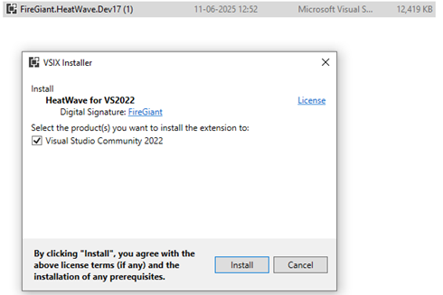
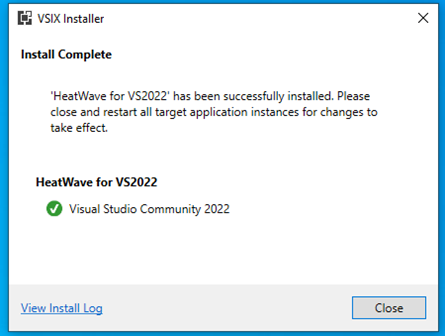
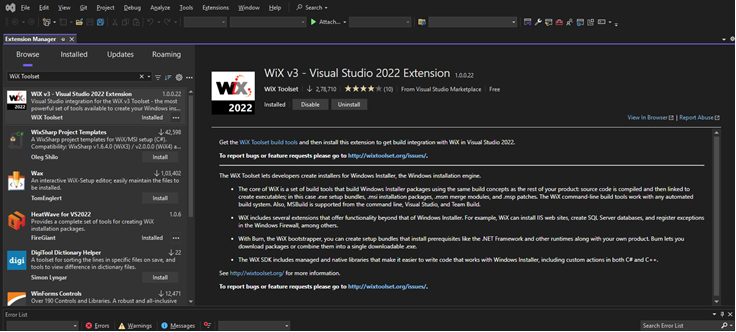

# Wix 6.0 Installer:

## Prerequisites

### .NET SDK:
 Download and install .NET SDK. -> https://dotnet.microsoft.com/en-us/download

### Visual Studio 2022:
Download and install Visual studio 2022. -> https://visualstudio.microsoft.com/vs/

### WiX Installer 6.0.1:
1. Uninstall the existing WiX installer and Download WiX installer 6.0.1-> 
https://github.com/wixtoolset/wix/releases/download/v6.0.1/wix-cli-x64.msi 
2. Install the Downloaded installer.
3. Set Environment Variable:
    
    (i). Under System variables, Check the WiX installer bin path( ex: C:\Program Files\WiX Toolset v6.0\bin\ ) . If the path is not present, click New. In the Variable name field, enter WIX6 and enter the path of WiX installer( ex: C:\Program Files\WiX Toolset v6.0\bin\ ) . Click OK.

    (ii). Under System variables, Double click ‘Path’ variable, and Click ‘New’, and then add the installation bin path and heat.exe path ( ex C:\Program Files\WiX Toolset v6.0\bin   and  C:\Program Files\WiX Toolset v6.0\bin\x86 ). Click OK

### HeatWave for VS2022:

1. Download and install HeatWave for VS2022 -> https://marketplace.visualstudio.com/_apis/public/gallery/publishers/FireGiant/vsextensions/FireGiantHeatWaveDev17/1.0.6/vspackage

2. During installation, verify ‘Visual studio community 2022’ is checked state. Please refer the below screenshot

### WiX v3 – Visual studio 2022 extension
1. Open Visual Studio 2022, go to Extensions > Manage Extensions, search for "WiX Toolset“ -> install ‘WiX v3 – Visual studio 2022 extension’. (WiX v3 – Visual studio 2022 extension  is used to create the WiX v3 project) . Refer below screenshot
2. Close the Visual studio after installation

### Prepare nosigned Build

Run _build_and_make_msi.bat for no signed build

### Prepare signed Build

Run _sign_build_and_make_msi.bat for signed build